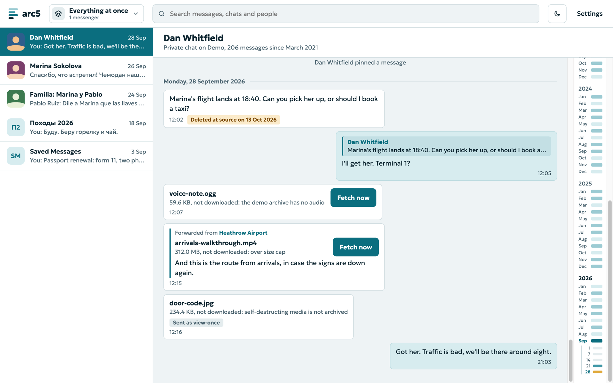
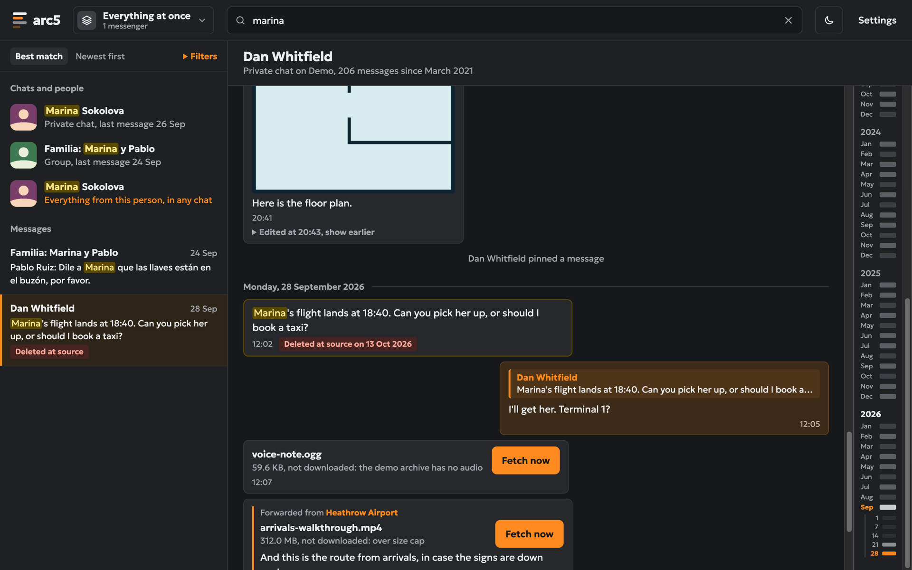
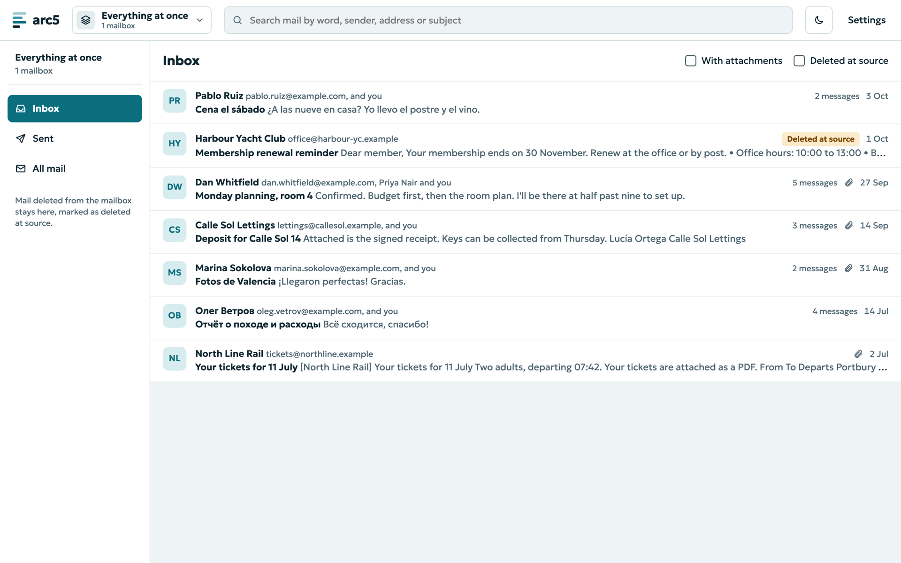
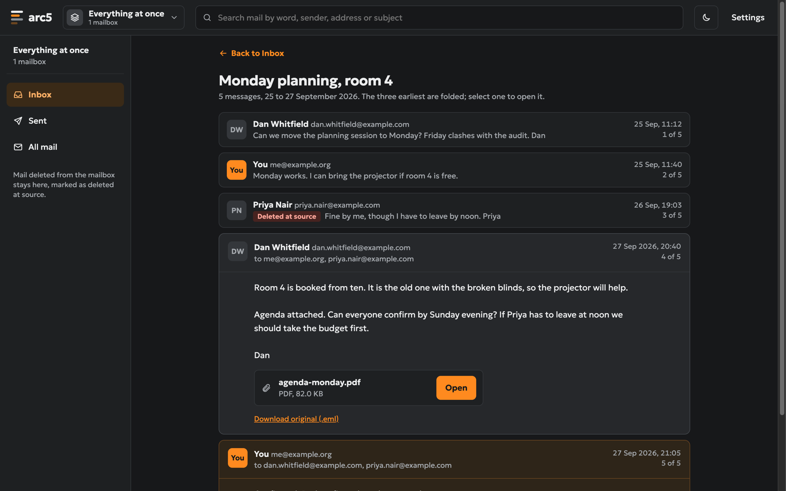

# arc5

**Your own copy of every chat and email: searchable, and safe from deletion.**

arc5 keeps a private, durable archive of your Telegram chats and your mailboxes
on a computer you own. Clean out your accounts, turn on auto-delete, or lose a
message someone else deleted, and arc5 still has it.



- **Keeps everything.** Messages, edits with their earlier text, photos and
  files. A message deleted in Telegram or on the mail server stays, marked as
  deleted.
- **Only reads.** arc5 never sends, deletes, moves or flags anything, and
  never marks mail as read.
- **Finds anything.** One search across every chat and mailbox, with word
  forms in 18 languages, phrases, and filters for people, dates and files.
- **Stays yours.** A single binary or container with one SQLite database. No
  cloud, no telemetry.

| Search | Mail | Dark mode |
|---|---|---|
|  |  |  |

> **Status:** early development. Telegram and email (IMAP, Gmail first) work;
> WhatsApp is planned.

## Run it

With Docker:

```sh
docker run -d --name arc5 -p 8080:8080 -v arc5-data:/data \
  -e TZ=Europe/Amsterdam fenelon/arc5
```

Open <http://localhost:8080> and choose a password. The image runs on amd64 and
arm64.

With Docker Compose:

```yaml
services:
  arc5:
    image: fenelon/arc5:latest
    restart: unless-stopped
    ports: ["8080:8080"]
    environment:
      TZ: Europe/Amsterdam
    volumes: ["arc5-data:/data"]
    stop_grace_period: 30s
volumes:
  arc5-data:
```

On a **Synology NAS**, use [`deploy/nas/compose.yaml`](deploy/nas/compose.yaml)
as a Container Manager project; its comments walk through the setup.

From source (Go 1.26, no cgo):

```sh
go build -o arc5 ./cmd/arc5
./arc5 demo --data ./demo    # optional: a sample archive to look around
./arc5 serve --data ./demo
```

### Settings

| Flag | Environment | Default | |
|---|---|---|---|
| `--listen` | `ARC5_LISTEN` | `127.0.0.1:8080` (`:8080` in the image) | Address to listen on |
| `--data` | `ARC5_DATA` | `data` (`/data` in the image) | Folder for the database and media |
| | `ARC5_PASSWORD` | none | Fixes the login password; otherwise you choose it in the browser |
| | `TZ` | | Time zone for dates |

The data folder holds connector logins that grant full access to your
accounts, so keep it private. To reach arc5 from elsewhere, use a VPN such as
Tailscale or a reverse proxy with TLS; behind a proxy that sends
`X-Forwarded-Proto: https`, the login cookie is marked `Secure`. `GET /healthz`
answers without a login.

## Add your accounts

Open **Sources**, then **Add a source**.

### Telegram

arc5 signs in as you, like a desktop app, so it needs API keys of your own:

1. At <https://my.telegram.org>, open "API development tools" and create an
   app. The form only says "ERROR" when it dislikes something: use a title of
   letters only (such as `ArcFive`), choose Desktop, and leave the URL empty.
2. In arc5, enter the API ID and hash, your phone number, the code Telegram
   sends, and your two-step password if you have one.

arc5 then fetches your history, newest chats first, and saves new messages,
edits and deletions as they happen. Private chats and groups are archived by
default; channels and bots when you choose them. Self-destructing and
view-once media are kept only if you turn that on. Secret chats are not
visible to arc5.

### Email

1. Type the address. The server is filled in for Gmail, Google Workspace,
   Fastmail, iCloud, Yahoo, GMX, mailbox.org, Yandex and Zoho.
2. Type an **app password**. For Gmail, turn on 2-Step Verification and create
   one at <https://myaccount.google.com/apppasswords>. Workspace accounts need
   their administrator to allow IMAP.

arc5 archives the Inbox, Sent and your own folders (on Gmail: Inbox, Sent and
All Mail, each message once). Every message keeps its original `.eml`;
HTML-only mail is shown as clean text. Microsoft mailboxes no longer accept
passwords from mail programs, so they cannot be added yet.

## Search

Words are ANDed, `"quoted words"` match as a phrase, and the last word also
matches as a prefix. Under **Settings**, choose the languages you write in so
that `cat` finds `cats`: Arabic, Danish, Dutch, English, Finnish, French,
German, Hungarian, Irish, Italian, Norwegian, Portuguese, Romanian, Russian,
Spanish, Swedish, Tamil and Turkish. Other languages are still found by exact
word, prefix and phrase.

## Develop

```sh
go vet ./... && go test -race -count=1 ./...
```

Pushes to `master` run the tests and publish the image to Docker Hub as
`latest`; a `v1.2.3` tag publishes `1.2.3` and `1.2`. The design and plans
are in [`docs/superpowers`](docs/superpowers).
